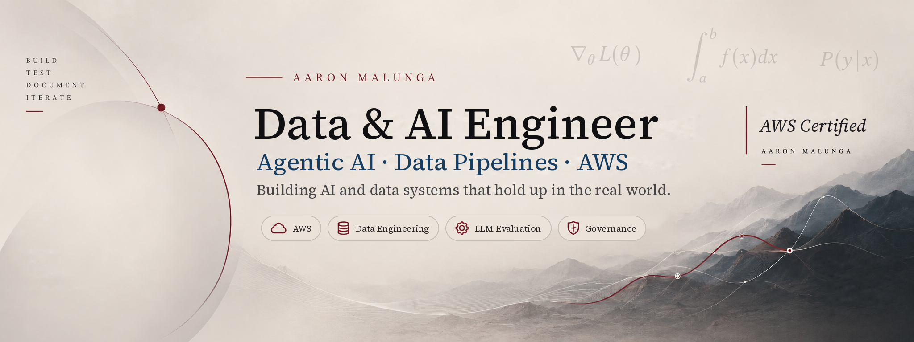

<p align="center">
  <picture>
    <source media="(prefers-color-scheme: dark)" srcset="./assets/github_banner_dark.png">
    
  </picture>
</p>

<p align="center">
  <a href="https://github.com/aaronmalunga"></a>
  <a href="https://www.linkedin.com/in/aaronmalunga/"></a>
</p>

<p align="center">
  <sub>Open to remote Data &amp; AI engineering roles · EMEA &amp; worldwide · UTC+2</sub>
</p>

---

## What I build

I build **agentic AI and data systems on AWS**, starting from a business question rather than a model.

Every project begins with a problem that can be stated in one sentence, is measured against a no-AI baseline, and treats **security, cost, evaluation and observability** as part of the build, not an afterthought.

> **Architecture principle:** intelligence does not automatically imply authority.

---

## Featured systems

<sub>● Shipped &nbsp;·&nbsp; ◐ In build &nbsp;·&nbsp; ○ Planned</sub>

### 01 · Reliora
**Trustworthy customer-support agents**

*Business question:* how much should an AI support agent be allowed to do on its own when a wrong action costs money?

Reliora tiers an agent's authority by risk, from read-only answers up to actions that need human approval, so routine requests run on their own while costly ones stay controlled.

**Focus**  
`Agentic AI` · `Amazon Bedrock` · `Human-in-the-loop` · `Observability` · `Governance`

**Evidence**  
`160+ automated tests` · `RL0–RL3 autonomy levels` · `Architecture decision records`

**Status:** ◐ In build

---

### 02 · Revenue Leakage Reconciliation *(working title)*
**Finance operations · AI-assisted reconciliation**

*Business question:* how much revenue slips between what was sold, what was delivered and what was billed, and can it be caught before month-end?

Detects mismatches across contracts, deliveries and invoices, then routes each case through a review lifecycle. Evaluated on public transaction data with injected, labelled leakage and compared against a rules-only baseline.

**Focus**  
`Agentic AI` · `Data Reconciliation` · `Evaluation` · `Python`

**Status:** ◐ In build · repo coming

---

### 03 · AgentGuard
**Spending controls for AI agents, built on PayPal**

*Business question:* when an AI agent can pay for things, what stops it from paying for the wrong thing?

A trust and risk layer that checks agent-initiated payments against policy before they execute. Entered in the **PayPal AI Hackathon**, and being built beyond the hackathon as a production-style product on AWS.

**Focus**  
`Agentic AI` · `Payments` · `Policy Enforcement` · `LLM Evaluation`

**Status:** ◐ In build

---

### 04 · NovaMart Multi-Agent Support
**Multi-agent orchestration · Udacity Future AWS Agent Engineer**

A five-agent orchestrator-to-workers support system (inventory, policy, refund and communication agents) with three Bedrock Knowledge Bases and Guardrails. Passed review on first submission.

**Focus**  
`Multi-Agent` · `Bedrock AgentCore` · `Strands Agents SDK` · `RAG`

**Status:** ● Shipped · [Repository](https://github.com/aaronmalunga/novamart-multi-agent-support)

---

<sub>○ **Planned:** experimentation &amp; causal decision-making, real-time fraud &amp; risk decisioning, and personalised ranking. Added here as each one ships.</sub>

---

## Hackathons & competitions

| Event | Project | Status |
|---|---|---|
| **PayPal AI Hackathon** (Devpost) | AgentGuard | ◐ In build |

---

## Technical stack

**Cloud & AI**

<p>
  
  
  
  
</p>

**Data & Engineering**

<p>
  
  
  
  
  
</p>

<sub>Tools are added here once a shipped project uses them.</sub>

---

## How I think about architecture

| Principle | What it means in practice |
|---|---|
| **Start with the business question** | Every project names the problem, the people who feel it and the metric that proves it's solved before any service is chosen. |
| **Separate intelligence from authority** | A model may recommend an action without automatically receiving permission to execute it. |
| **Beat a dumb baseline** | Every AI component is measured against a rules-only or no-AI version, and has to earn its place. |
| **Treat cost as architecture** | Idle infrastructure, scaling behaviour and teardown are design decisions, not billing afterthoughts. |

---

## AWS certifications

| Credential | Status |
|---|---|
| **AWS Certified AI Practitioner** | ● **[Earned · 2026 ↗](https://www.credly.com/badges/1d53fa3d-7718-4d04-8227-c95aecee6333/public_url)** |
| **AWS Certified Cloud Practitioner** | ◐ Scheduled · Nov 2026 |

<details>
<summary><sub>Full certification roadmap</sub></summary>
<br/>

| Level | Credential | Status |
|---|---|---|
| Business | AWS AI Business Strategist | ○ Planned |
| Associate | AWS Certified Solutions Architect | ○ Planned · 2027 |
| Associate | AWS Certified Data Engineer | ○ Planned · 2027 |
| Associate | AWS Certified Machine Learning Engineer | ○ Planned · 2027 |

Planned credentials are a roadmap, not credentials held.

</details>

---

## Currently

```text
→ Building        Reliora · Revenue Leakage Reconciliation · AgentGuard
→ Studying        AWS Cloud Practitioner · B.Sc. Data Science (IU)
→ Deepening       LLM evaluation, data engineering on AWS
```

---

<p align="center">
  <b>Agentic AI · Data Pipelines · AWS</b><br/>
  <sub>Systems &gt; spectacle.</sub>
</p>
